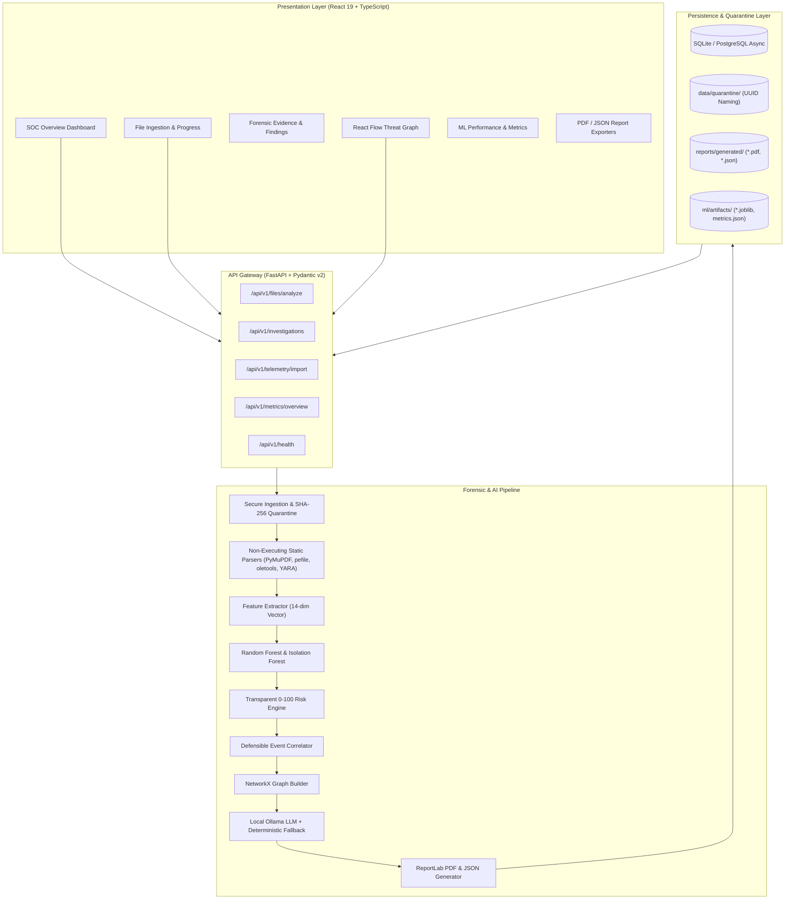
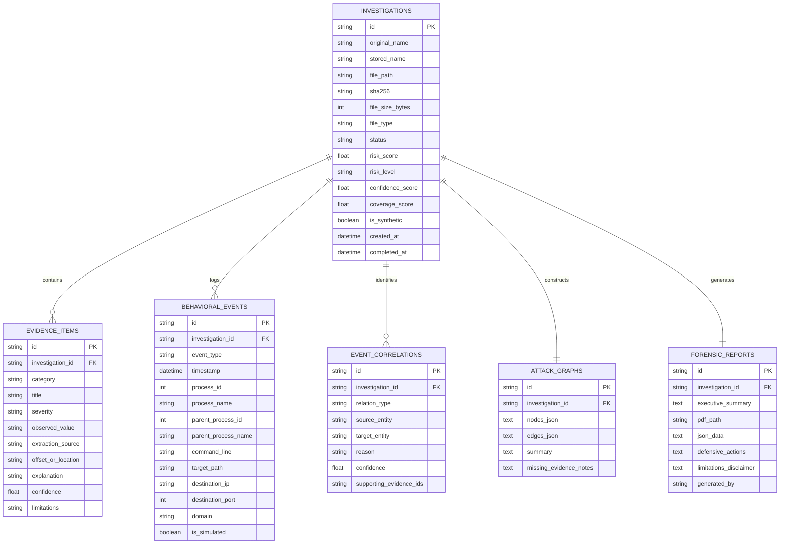

# System Architecture & Technical Specifications

**Project Title:** AI-Powered Malicious File Forensics and Threat Reconstruction System  
**Academic Session:** 2026–2027 • SRM University Delhi-NCR, Sonipat  
**Department:** Computer Science & Engineering (Data Science & AI)  

---

## 1. High-Level System Architecture

---

## 2. Database Schema (Entity-Relationship)

---

## 3. Machine Learning Methodology

### 3.1 Feature Vector Architecture (14 Dimension Predictors)
1. `file_size_kb`: Total file size in kilobytes.
2. `shannon_entropy`: Byte randomness ($0.0 \le H \le 8.0$).
3. `url_count`: Extracted HTTP/HTTPS URLs.
4. `ip_count`: Extracted non-loopback IPv4 indicators.
5. `domain_count`: Extracted domain indicators.
6. `embedded_objects_count`: Count of embedded streams, binaries, or objects.
7. `yara_matches_count`: Matched rule signatures from `malware_rules.yar`.
8. `critical_evidence_count`: Count of critical-severity forensic findings.
9. `high_evidence_count`: Count of high-severity forensic findings.
10. `medium_evidence_count`: Count of medium-severity forensic findings.
11. `suspicious_api_count`: Count of dangerous Win32 API imports (`VirtualAlloc`, `WriteProcessMemory`, `CreateRemoteThread`).
12. `macro_present`: Binary flag indicating presence of VBA macros (`vbaProject.bin`, `AutoOpen`).
13. `double_extension`: Binary flag indicating masquerading (`.pdf.exe`).
14. `script_patterns_count`: Count of download cradles, hidden execution styles, or base64 decode primitives.

### 3.2 Dual-Model Inference Strategy
- **Supervised Random Forest**: Learns complex decision boundaries with Gini impurity splitting and balanced class weighting. Provides explicit feature importances and calibrated class probability.
- **Unsupervised Isolation Forest**: Fitted exclusively on benign reference baselines. Measures path length to isolate an observation. Anomalous zero-day samples or novel packers require fewer splits and produce high anomaly scores.
